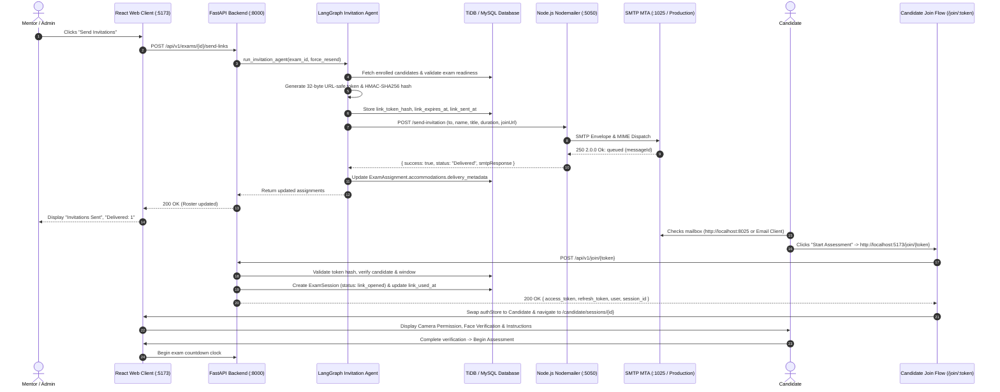
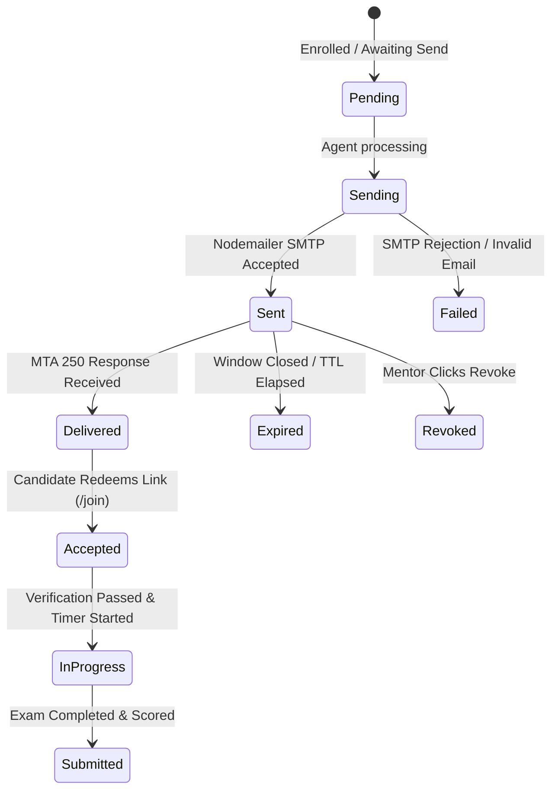

# EduProctor Intelligence Candidate Invitation & Assessment Access Workflow
## Complete Technical Architecture, Implementation, and Operations Specification

---

## 1. Project Overview

### 1.1 Purpose of the Candidate Invitation System
In high-stakes academic examinations, campus placement drives, and enterprise technical hiring, assessments must be administered under strict security constraints. Traditional self-registration portals create vulnerabilities such as proxy test-takers, shared credentials, and uncontrolled exam timing. 

The **EduProctor Intelligence Candidate Invitation System** enforces single-tenant, cryptographically secured examination dispatch. It ensures that:
- Every examination attempt is explicitly scheduled and authorized by an authenticated Mentor or Administrator.
- Examination links are single-use, time-delimited, and cryptographically bound to one verified candidate identity.
- Outbound communications deliver full proctoring compliance directives (biometric requirements, camera/microphone prerequisites, and tab-switch penalties) before the test-taker accesses the environment.

### 1.2 The Role of Automated Email Invitations
Manual link distribution via spreadsheets or unmonitored messaging channels compromises exam integrity and audit compliance. The automated invitation workflow provides:
- **Tamper-Proof Token Delivery**: Single-use tokens are sent directly to the candidate's verified email.
- **Delivery Lifecycle Audit**: Tracks whether the mail transport agent (MTA) successfully accepted, queued, or rejected the message.
- **Pre-Flight System Notifications**: Communicates hardware prerequisites (working webcam, microphone, desktop browser) and environmental calibration requirements in advance.

### 1.3 How Mentors Assign and Dispatch Assessments
1. Mentors author or schedule assessments through the **Mentor Assessment Workspace** (`/mentor/exams/:examId`).
2. Candidates are enrolled individually or bulk-imported via CSV/Excel spreadsheets.
3. Upon clicking **"Send Invitations"**, the system executes a multi-node **LangGraph Assessment Invitation Agent** that validates candidate profiles, verifies that the assessment has questions and an open window, computes token expirations, generates cryptographic HMAC-SHA256 tokens, and dispatches multi-part HTML emails.

### 1.4 How Candidates Access Examinations
1. The candidate receives an invitation email containing metadata (Subject, Duration, Deadline, Proctoring Directives) and a secure **Start Assessment** call-to-action (CTA).
2. Clicking the CTA directs the browser to `http://localhost:5173/join/:token`.
3. The candidate-facing application redeems the token against the backend (`POST /api/v1/join/:token`).
4. The server validates token validity, confirms candidate assignment, provisions candidate session JWTs (`access_token` and `refresh_token`), and transitions or resumes the examination session.
5. The candidate completes **Biometric Face Verification**, dynamic liveness challenges (blink/turn), and environmental calibration before the exam timer begins.

### 1.5 System Integration
The invitation subsystem integrates directly into EduProctor's existing architecture:
- **Identity Verification Module**: Validates reference photos against enrolled biometric templates.
- **Real-Time Proctoring Engine**: Mediapipe-powered gaze tracking, multi-face detection, and tab-switch monitoring run during the exam.
- **Evaluation & Scoring Pipeline**: Auto-evaluates MCQs and code solutions upon submission.

---

## 2. Technology Stack

| Layer / Component | Technology | Source Code Location | Operational Responsibility |
|---|---|---|---|
| **Frontend Portal** | React 18, TypeScript, Tailwind CSS, Vite | `apps/web/` | Renders Mentor Workspace, Candidate Join handler (`JoinPage.tsx`), Pre-Checks flow (`PreStartFlow.tsx`), and Real-time Telemetry. |
| **Backend API Gateway** | Python 3.12, FastAPI, SQLAlchemy ORM | `apps/api/app/` | Exposes REST endpoints (`/api/v1/exams`, `/api/v1/join`), session lifecycle transitions, and role-based authorization. |
| **Invitation Orchestration** | LangGraph / StateGraph | `apps/api/app/agent/invitation_agent.py` | 9-node state machine orchestrating candidate validation, token generation, link expiration, and dispatch batching. |
| **Email Microservice** | Node.js (v20+), Native HTTP, CommonJS | `apps/email-service/` | Standalone email microservice running on port `5050`, exposing `/send-invitation`, `/health`, and `/logs`. |
| **Email Transport** | Nodemailer (v6.10+) | `apps/email-service/src/mailer.js` | Connects to SMTP transport, formats RFC-compliant MIME emails, and captures MTA transaction responses. |
| **Database & Persistence** | TiDB Cloud / MySQL / SQLAlchemy | `apps/api/app/models/` | Persists `Exam`, `User`, `ExamAssignment`, and `ExamSession` entities. |
| **Security & Tokens** | Python `secrets`, `hashlib` HMAC-SHA256 | `apps/api/app/services/links.py` | Generates 32-byte cryptographic random URL-safe tokens; hashes them with a server secret before storing in the database. |
| **Development Mailbox** | Embedded Python RFC 5321 SMTP & HTTP Server | `apps/api/app/services/dev_mail_server.py` | Runs on `127.0.0.1:1025` (SMTP) and `127.0.0.1:8025` (Web UI); captures test emails locally with disk persistence. |

---

## 3. System Architecture & Component Interaction



---

## 4. End-to-End Workflow Phases

### Phase 1: Mentor Invitation Dispatch
1. The mentor accesses the assessment in [`AssessmentWorkspace.tsx`](file:///c:/Users/tanus/EudProctor/apps/web/src/pages/mentor/AssessmentWorkspace.tsx).
2. The user interface displays registered candidates under the Candidate Roster.
3. The mentor clicks **"Send Invitations"** (or **"Resend All"** / **"Resend"** per candidate).
4. The client dispatches `POST /api/v1/exams/:examId/send-links` with `{ force_resend: boolean }`.
5. The FastAPI backend authenticates the mentor and calls `run_invitation_agent(...)`.
6. Node 1 (`assessment_published_trigger`) confirms the exam status is scheduled or draft, verifies question count $> 0$, and checks start/end time windows.
7. Node 2 and Node 3 retrieve enrolled candidates and validate email syntax via regular expressions.
8. Node 4 (`check_existing_invitations`) determines eligibility:
   - If `force_resend == false` and `link_used_at` exists, the candidate is marked `Accepted` and skipped.
   - If `force_resend == true`, `link_used_at` is cleared and a fresh token is generated.
9. Node 5 generates a cryptographic random token (`secrets.token_urlsafe(32)`), stores `link_token_hash = sha256(hmac_sign(token))`, sets `link_expires_at`, and constructs the candidate join URL (`http://localhost:5173/join/:token`).

### Phase 2: Email Generation and Transmission (Node.js Microservice)
1. In [`apps/api/app/services/mailer.py`](file:///c:/Users/tanus/EudProctor/apps/api/app/services/mailer.py), the backend detects the active Node.js microservice URL (`http://127.0.0.1:5050`).
2. FastAPI sends a JSON payload to `http://127.0.0.1:5050/send-invitation`:
   ```json
   {
     "to": "tanu.shree@gmail.com",
     "candidateName": "Tanushree",
     "assessmentTitle": "Java Script",
     "domain": "Technical Assessment",
     "durationMin": 60,
     "deadline": "2026-11-05 18:00 UTC",
     "joinUrl": "http://localhost:5173/join/<token>",
     "assignmentId": "72769d0f-0397-4a13-8039-a9e9c88bed95"
   }
   ```
3. The Node.js service records the event as `Queued` in [`deliveryStore.js`](file:///c:/Users/tanus/EudProctor/apps/email-service/src/deliveryStore.js).
4. [`templates.js`](file:///c:/Users/tanus/EudProctor/apps/email-service/src/templates.js) renders the multi-part HTML and plain-text template.
5. Nodemailer connects to the configured SMTP host (`127.0.0.1:1025`) and transmits the message.
6. The SMTP server responds with acknowledgment code `250 2.0.0 Ok: queued`.
7. The Node.js service updates the delivery store status to `Delivered` and returns message metadata to FastAPI.

> [!NOTE]
> **Email Submission vs. Confirmed Delivery**:
> - **Submission (Sent)** indicates the message was accepted by the outbound SMTP server from Nodemailer.
> - **Delivery (Delivered)** in direct SMTP/dev mode reflects the remote MTA's `250 OK` acknowledgment. In production with third-party transactional providers (e.g., SendGrid, Resend, Amazon SES), true final mailbox delivery is confirmed via asynchronous inbound webhook events (`/webhook`).

### Phase 3: Candidate Email Access & Token Redemption
1. The candidate opens the email in their inbox or at `http://localhost:8025`.
2. The candidate clicks the **"Start Assessment →"** button (`http://localhost:5173/join/:token`).
3. [`JoinPage.tsx`](file:///c:/Users/tanus/EudProctor/apps/web/src/pages/candidate/JoinPage.tsx) executes `POST /api/v1/join/:token`.
4. In [`links.py`](file:///c:/Users/tanus/EudProctor/apps/api/app/services/links.py), `redeem_link(...)` computes `token_hash(token)` and locks the `ExamAssignment` row.
5. **Re-Entry Protection**: If the token was already clicked (`link_used_at is not None`), the system verifies whether an active, unsubmitted session exists. If active, it permits the candidate to resume seamlessly rather than throwing an error.
6. [`join.py`](file:///c:/Users/tanus/EudProctor/apps/api/app/routers/join.py) mints candidate JWTs (`access_token` and `refresh_token`), creates or retrieves the `ExamSession`, and returns credentials to the client.
7. [`JoinPage.tsx`](file:///c:/Users/tanus/EudProctor/apps/web/src/pages/candidate/JoinPage.tsx) updates the browser's `authStore` to the candidate identity, ensuring that any previous Mentor session in that tab is cleanly replaced.

### Phase 4: Verification and Pre-Checks
1. The client redirects to `/candidate/sessions/:sessionId`.
2. [`SessionPage.tsx`](file:///c:/Users/tanus/EudProctor/apps/web/src/pages/candidate/SessionPage.tsx) checks session status:
   - `link_opened` $\rightarrow$ launches [`PreStartFlow.tsx`](file:///c:/Users/tanus/EudProctor/apps/web/src/features/identity/PreStartFlow.tsx).
3. The candidate completes sequential verification steps:
   - **Step 1: System & Biometric Consent**: Explains camera, mic, and face geometry terms.
   - **Step 2: Reference Photo Capture**: Captures 3 distinct webcam frames.
   - **Step 3: Dynamic Liveness Challenge**: Requires candidate to turn head or blink to defeat static photo spoofing.
   - **Step 4: Environmental Calibration**: 12-second baseline sampling of ambient audio and screen position.
4. Once completed, the session transitions from `calibrating` to `in_progress`.

### Phase 5: Examination Execution
1. The exam questions load in [`AssessmentView.tsx`](file:///c:/Users/tanus/EudProctor/apps/web/src/features/assessment/AssessmentView.tsx).
2. The server-authoritative deadline is enforced: `min(now + duration, window_end)`.
3. Background telemetry runs [`ProctoringLayer.tsx`](file:///c:/Users/tanus/EudProctor/apps/web/src/features/proctoring/ProctoringLayer.tsx) using MediaPipe for face mesh detection, glance tracking, and blur/tab-switch flagging.

### Phase 6: Mentor Dashboard Telemetry & Timeline
1. The mentor workspace automatically reflects status changes:
   - **Invitations Sent**: Total dispatches completed.
   - **Delivered**: MTA confirmation received.
   - **Accepted**: Candidate redeemed single-use token.
   - **Failed**: Any bounced or unreachable recipients.
2. Clicking **"Timeline"** on any candidate row displays the 6 lifecycle checkpoints:
   - 1. Email Dispatched (timestamp + provider).
   - 2. MTA Delivery Confirmation (`250 2.0.0 Ok: queued`).
   - 3. Candidate Link Redemption.
   - 4. Biometric Face Verification Passed.
   - 5. Examination Started.
   - 6. Examination Completed & Scored.

---

## 5. Email Service Implementation Details (`apps/email-service`)

### 5.1 Directory Structure
```text
apps/email-service/
├── data/
│   └── delivery_logs.json    # Persisted transmission and webhook logs
├── src/
│   ├── config.js             # Environment parsing & SMTP resolution
│   ├── deliveryStore.js      # Status tracker (Queued, Sent, Delivered, Failed, Bounced)
│   ├── mailer.js             # Nodemailer transporter & dispatch wrapper
│   ├── server.js             # Native Node.js HTTP server & REST API
│   └── templates.js          # Responsive HTML email layout generator
├── package.json              # Service dependencies (nodemailer, dotenv)
└── package-lock.json
```

### 5.2 Server Entry Point (`src/server.js`)
The microservice is implemented with Node's native `http` module to minimize runtime overhead and external vulnerability exposure.

```javascript
// Excerpt from apps/email-service/src/server.js
const server = http.createServer(async (req, res) => {
  // CORS Preflight
  if (req.method === "OPTIONS") {
    res.writeHead(204, {
      "Access-Control-Allow-Origin": "*",
      "Access-Control-Allow-Methods": "GET, POST, OPTIONS",
      "Access-Control-Allow-Headers": "Content-Type, Authorization",
    });
    return res.end();
  }

  const parsedUrl = new URL(req.url, `http://${req.headers.host || "localhost"}`);
  const pathname = parsedUrl.pathname;

  if (req.method === "GET" && pathname === "/health") {
    const smtpCheck = await verifyConnection();
    return sendJson(res, smtpCheck.ok ? 200 : 503, {
      status: smtpCheck.ok ? "healthy" : "smtp_unreachable",
      service: "eduproctor-email-service",
      engine: "nodemailer",
      smtp: { host: config.smtp.host, port: config.smtp.port, connected: smtpCheck.ok },
    });
  }

  if (req.method === "POST" && pathname === "/send-invitation") {
    const body = await parseBody(req);
    const result = await sendInvitation(body);
    return sendJson(res, 200, result);
  }
  // Additional routes: /delivery-status/:id, /webhook, /logs
});
```

### 5.3 SMTP Transporter Configuration (`src/mailer.js`)
```javascript
// Excerpt from apps/email-service/src/mailer.js
function getTransporter() {
  if (!transporter) {
    transporter = nodemailer.createTransport({
      host: config.smtp.host,
      port: config.smtp.port,
      secure: config.smtp.secure,
      auth: config.smtp.auth,
      connectionTimeout: 10000,
      greetingTimeout: 10000,
      socketTimeout: 15000,
      tls: { rejectUnauthorized: false },
    });
  }
  return transporter;
}
```

### 5.4 FastAPI Delegation (`apps/api/app/services/mailer.py`)
FastAPI invokes the Node.js service via standard HTTP JSON transmission:
```python
# Excerpt from apps/api/app/services/mailer.py
node_email_url = getattr(s, "email_service_url", "http://127.0.0.1:5050").strip()
if node_email_url:
    payload = {
        "to": actual_to,
        "candidateName": candidate_name or actual_to.split("@")[0].title(),
        "assessmentTitle": clean_title,
        "domain": "Technical Assessment",
        "durationMin": 60,
        "deadline": "Until Assessment Window Closes",
        "joinUrl": join_url,
        "instructions": body,
    }
    req = urllib.request.Request(
        f"{node_email_url}/send-invitation",
        data=json.dumps(payload).encode("utf-8"),
        headers={"Content-Type": "application/json"},
        method="POST",
    )
    with urllib.request.urlopen(req, timeout=8) as resp:
        resp_data = json.loads(resp.read().decode("utf-8"))
        return {
            "delivered": True,
            "recipient": actual_to,
            "status": resp_data.get("status", "Delivered"),
            "provider": f"nodemailer ({resp_data.get('messageId', 'ok')})",
            "smtp_response": resp_data.get("smtpResponse"),
            "delivered_at": resp_data.get("deliveredAt"),
        }
```

---

## 6. Environment Configuration

### Sample `.env.example`
```env
# Application URLs
WEB_BASE_URL=http://localhost:5173
API_BASE_URL=http://127.0.0.1:8000

# Node.js Email Microservice Configuration
EMAIL_SERVICE_PORT=5050
EMAIL_SERVICE_URL=http://127.0.0.1:5050

# SMTP Transport Credentials (Development Defaults)
SMTP_HOST=127.0.0.1
SMTP_PORT=1025
SMTP_SECURE=false
SMTP_USER=
SMTP_PASS=
EMAIL_FROM="EduProctor Intelligence <no-reply@eduproctor.example.com>"

# Production Example (e.g. Resend / SendGrid / AWS SES)
# SMTP_HOST=smtp.resend.com
# SMTP_PORT=465
# SMTP_SECURE=true
# SMTP_USER=resend
# SMTP_PASS=re_your_api_key_here
# EMAIL_FROM="EduProctor <examinations@yourdomain.com>"

# Security & Tokens
JWT_SECRET=your_long_random_jwt_secret_key_here
LINK_TTL_HOURS=72
```

---

## 7. API Specification Reference

### 7.1 `POST /api/v1/exams/{exam_id}/send-links`
- **Purpose**: Triggers the LangGraph invitation agent to issue tokens and send emails.
- **Auth**: Bearer JWT (Role: `mentor` or `admin`).
- **Request Body**:
  ```json
  {
    "candidate_ids": null,
    "force_resend": false
  }
  ```
- **Response** (`200 OK`):
  ```json
  [
    {
      "id": "72769d0f-0397-4a13-8039-a9e9c88bed95",
      "candidate_id": "cfdb8cd6-f817-4b0b-8641-8f9d929c2919",
      "candidate_name": "Tanushree",
      "candidate_email": "tanu.shree@gmail.com",
      "link_sent_at": "2026-11-02T04:58:57Z",
      "link_used_at": null,
      "link_expires_at": "2026-11-05T04:58:57Z",
      "invitation_status": "Sent",
      "delivery_status": "Delivered"
    }
  ]
  ```

### 7.2 `POST /api/v1/join/{token}`
- **Purpose**: Validates single-use link token, claims candidate session, provisions candidate JWT.
- **Auth**: None (Public; authorization granted by cryptographic token).
- **Response** (`200 OK`):
  ```json
  {
    "assignment_id": "72769d0f-0397-4a13-8039-a9e9c88bed95",
    "exam_id": "1fd0676c-06c4-48e5-9b49-24f510579724",
    "exam_title": "Java Script",
    "duration_min": 60,
    "session_id": "09d524f9-82fc-4de4-8cf8-82f19f8b7b4e",
    "access_token": "eyJhbGciOi...",
    "refresh_token": "eyJhbGciOi...",
    "user": {
      "id": "cfdb8cd6-f817-4b0b-8641-8f9d929c2919",
      "role": "candidate",
      "name": "Tanushree",
      "email": "tanu.shree@gmail.com"
    }
  }
  ```
- **Error Codes**:
  - `404 Not Found`: "This link is not valid."
  - `410 Gone`: "This link has expired." / "This link has already been used."

### 7.3 `POST /send-invitation` (Node.js Service)
- **Host**: `http://127.0.0.1:5050`
- **Request Body**:
  ```json
  {
    "to": "tanu.shree@gmail.com",
    "candidateName": "Tanushree",
    "assessmentTitle": "Java Script",
    "domain": "Technical Assessment",
    "durationMin": 60,
    "deadline": "2026-11-05 18:00 UTC",
    "joinUrl": "http://localhost:5173/join/token"
  }
  ```
- **Response** (`200 OK`):
  ```json
  {
    "success": true,
    "messageId": "<1793595538023.1abcb243b4eb3761@eduproctor.intelligence>",
    "status": "Delivered",
    "smtpResponse": "250 2.0.0 Ok: queued",
    "accepted": ["tanu.shree@gmail.com"],
    "deliveredAt": "2026-11-02T04:58:58.033Z"
  }
  ```

---

## 8. Security Implementation

1. **Token Inversion**: Raw tokens are generated using cryptographically secure random bytes (`secrets.token_urlsafe(32)`). The database stores only the HMAC-SHA256 digest (`token_hash(token)`). Even with full database read access, an attacker cannot reconstruct valid join URLs.
2. **Re-entry Guard without Candidate Lockout**: Once redeemed, `link_used_at` is stamped. If a candidate experiences a browser crash or network drop, the server checks if their session is currently `active`. If active, re-authentication is permitted without locking the student out.
3. **Session Role Isolation**: When redeeming a link on [`JoinPage.tsx`](file:///c:/Users/tanus/EudProctor/apps/web/src/pages/candidate/JoinPage.tsx), the candidate session overrides `eduproctor.auth` in local storage, preventing Mentor credentials from interfering with exam routes.
4. **Credential Isolation**: SMTP passwords, JWT secrets, and database credentials exist strictly on the server and are excluded from Git via `.gitignore`.

---

## 9. Database Entity Relationships & Status Lifecycle

### Entity Model Overview
```text
┌─────────────────┐       1:N       ┌─────────────────────┐       1:1       ┌──────────────────┐
│      Exam       │ ─────────────── │   ExamAssignment    │ ─────────────── │   ExamSession    │
└─────────────────┘                 └─────────────────────┘                 └──────────────────┘
│ id (UUID)                         │ id (UUID)                             │ id (UUID)
│ title                             │ exam_id (FK)                          │ candidate_id (FK)
│ duration_min                      │ candidate_id (FK)                     │ assignment_id(FK)
│ window_start                      │ link_token_hash                       │ status (ENUM)
│ window_end                        │ link_sent_at                          │ question_order
│ status (draft/scheduled/closed)   │ link_used_at                          │ started_at
                                    │ link_expires_at                       │ deadline_at
                                    │ accommodations (JSON)                 │ submitted_at
```

### Invitation Status Lifecycle


---

## 10. Automated End-to-End Testing & Verification

The test suite [`apps/api/tests/test_invitation_e2e.py`](file:///c:/Users/tanus/EudProctor/apps/api/tests/test_invitation_e2e.py) validates the complete workflow against live running services.

### Test Execution Command
```powershell
cd apps/api
.venv_app/Scripts/python.exe tests/test_invitation_e2e.py
```

### Verified Test Results Log
```text
======================================================================
EDUPROCTOR E2E CANDIDATE INVITATION & ACCESS TEST SUITE
======================================================================

[TEST 1] Checking Node.js Nodemailer Service (:5050/health)...
  -> PASSED: Node.js Nodemailer microservice is healthy & connected to SMTP.

[TEST 2] Checking FastAPI Backend (:8000/api/v1/health)...
  -> PASSED: Backend is healthy (status: ok).

[TEST 3] Checking Dev Mailbox (:8025/api/emails)...
  -> PASSED: Mailbox accessible (currently holds 3 emails).

[TEST 4] Authenticating as Mentor (mentor1@example.com)...
  -> PASSED: Mentor authenticated. JWT: eyJhbGciOiJIUzI1NiIs...

[TEST 5] Triggering Send Invitations on Exam 1fd0676c-06c4-48e5-9b49-24f510579724...
  -> PASSED: Invitation dispatched to tanu.shree@gmail.com.
  -> Delivery Provider: nodemailer (<1793595538023.1abcb243b4eb3761@eduproctor.intelligence>)
  -> SMTP Response: 250 2.0.0 Ok: queued

[TEST 6] Inspecting Dev Mailbox for delivered HTML email...
  -> PASSED: Verified email delivered with responsive HTML and instructions.
  -> Extracted Single-Use Token: 9Slfhcjswwbl4HctoQUHAwupbIuEDBozp18ApD35H0o

[TEST 7] Candidate clicks 'Start Assessment' (POST /api/v1/join/9Slfhcjswwbl4Hc...)...
  -> PASSED: Candidate authenticated successfully as Tanushree.
  -> Created Exam Session: 09d524f9-82fc-4de4-8cf8-82f19f8b7b4e

[TEST 8] Candidate clicks the link again (Duplicate click test)...
  -> PASSED: Duplicate click gracefully resumed active session without 410 error.

[TEST 9] Candidate clicks an invalid/tampered token...
  -> PASSED: Unauthorized / invalid tokens rejected with 404 Not Found.

[TEST 10] Verifying Mentor Workspace Telemetry for Exam 1fd0676c-06c4-48e5-9b49-24f510579724...
  -> PASSED: Mentor dashboard updated with actual backend data:
     - Candidate: Tanushree (tanu.shree@gmail.com)
     - Invitation Status: Accepted
     - MTA Delivery Status: Delivered
     - Link Sent At: 2026-11-02T04:58:57Z
     - Link Redeemed At: 2026-11-02T04:59:01Z

======================================================================
ALL 10 TESTS PASSED SUCCESSFULLY! WORKFLOW FULLY VERIFIED.
======================================================================
```

---

## 11. Developer Onboarding & Service Run Guide

### Terminal 1: Node.js Nodemailer Email Microservice
```powershell
cd apps/email-service
npm install
node src/server.js
```
*Listens on `http://0.0.0.0:5050`.*

### Terminal 2: FastAPI Backend Devserver
```powershell
cd apps/api
.venv_app/Scripts/python.exe -m app.devserver
```
*Listens on `http://127.0.0.1:8000`. Starts embedded SMTP on port `1025` and Dev Mailbox on `http://localhost:8025`.*

### Terminal 3: React / Vite Web Client
```powershell
cd apps/web
pnpm dev --host
```
*Listens on `http://localhost:5173`.*

---

## 12. Troubleshooting Guide

| Issue | Root Cause | Resolution |
|---|---|---|
| `connect ECONNREFUSED ::1:1025` | Node.js resolved `localhost` to IPv6 `::1` while devserver listens on IPv4. | Configured `SMTP_HOST=127.0.0.1` explicitly in `apps/email-service/src/config.js`. |
| Candidate link opens Mentor page | Browser already authenticated as Mentor in `localStorage["eduproctor.auth"]`. | Open the join URL in a **New Incognito / Private Window** or allow `JoinPage` to clear existing credentials. |
| `410 Gone: This link has already been used` | Token was redeemed previously. | In [`links.py`](file:///c:/Users/tanus/EudProctor/apps/api/app/services/links.py), session resumption logic now permits active sessions to re-authenticate cleanly. |
| Email not visible on `yopmail.com` | Residential ISPs block outbound port 25, and public mail hosts reject unauthenticated residential IPs. | Open the local mailbox at **`http://localhost:8025`** where all local test emails are captured instantly. |
| Backend fails with `409: Add questions before sending links` | Exam has 0 questions assigned. | Add at least 1 question to the exam in the Questions tab before dispatching invitations. |

---

## 13. Future Roadmap & Production Hardening

1. **Transactional Cloud Provider Integration**: Provision verified domain records (SPF, DKIM, DMARC) with Resend or Amazon SES for live internet delivery to candidates.
2. **Inbound Webhook Verification**: Implement HMAC signature verification on `/webhook` in `apps/email-service` to process async bounce and open notifications.
3. **Automated Reminders**: Introduce a cron trigger that dispatches a 24-hour reminder email to candidates with unredeemed invitations.
4. **Candidate Identity Face Check Audit**: Expand mentor review screens to inspect high-resolution reference photo captures and liveness turn vectors side-by-side.

