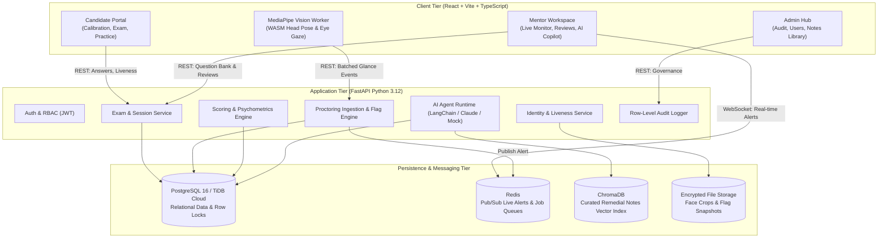
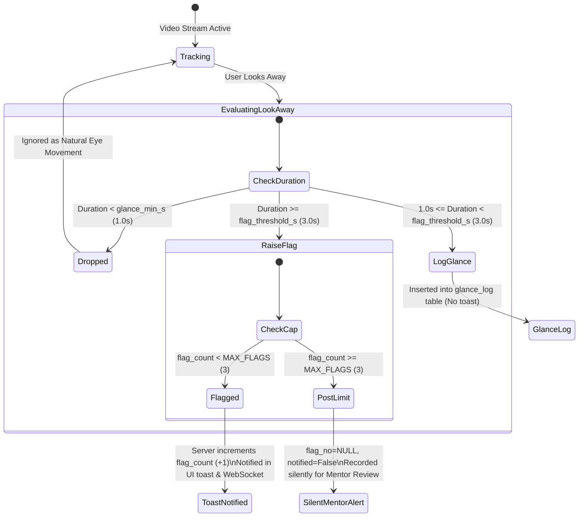
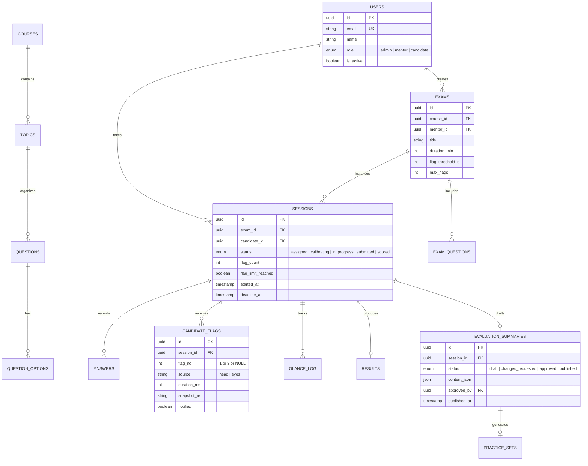

# EduProctor Intelligence — Comprehensive Project Documentation

## 1. Executive Summary

**EduProctor Intelligence** is an enterprise-grade assessment, calm proctoring, and automated evaluation platform designed for higher education institutions, coding bootcamps, and professional training providers.

Unlike traditional invasive proctoring software that causes student panic, triggers aggressive false positives, or relies on opaque algorithms, EduProctor is built around three foundational pillars:
1. **Calm, Human-Centric Proctoring**: Non-punitive browser-side monitoring using client-side WebAssembly computer vision (MediaPipe). Video never leaves the student's browser; only cryptographic event logs and small encrypted snapshots are stored.
2. **AI Question & Evaluation Agents**: Autonomous agents assist mentors in generating pedagogically sound multiple-choice questions, and automatically synthesize deep diagnostic evaluation summaries analyzing student strengths, misconceptions, and recommended remedial topics.
3. **Strict Human-in-the-Loop Governance**: AI drafts are strictly reviewed and approved by mentors before candidates ever see them. LLMs are physically partitioned from exam marks and proctoring telemetry to eliminate bias and hallucinations.

---

## 2. High-Level System Architecture

EduProctor is structured as a **modular monolith** with clean boundary segregation between domain services, asynchronous worker jobs, and presentation layers.



---

## 3. Technology Stack & Key Libraries

| Component | Technology | Rationale |
|---|---|---|
| **Backend Framework** | **FastAPI (Python 3.12)** | Asynchronous REST endpoints, strict Pydantic v2 validation, native OpenAPI docs |
| **Package Manager** | **uv** | Blazing-fast dependency resolution and virtual environment isolation |
| **Database ORM** | **SQLAlchemy 2.0 (Async + Sync) & Alembic** | Schema migrations, connection pooling, pessimistic row locking (`with_for_update`) |
| **Primary Relational DB**| **PostgreSQL 16** (Dev/Local) / **TiDB Cloud** (Distributed Cloud MySQL) | Full ACID transactions, row locking for flag concurrency, JSONB attributes |
| **Pub/Sub & Caching** | **Redis** | Sub-millisecond WebSocket fanout for mentor live-monitoring |
| **Vector Database** | **ChromaDB + bge-small-en-v1.5** | Semantic ranking of peer-reviewed mentor study notes |
| **Face & Liveness Engine**| **InsightFace (ArcFace + Anti-Spoofing)** / Pixel Fallback | Multi-photo enrollment, cosine similarity matching, blink/turn challenges |
| **Client-side Vision** | **MediaPipe Tasks Vision (WebAssembly Worker)** | 3D face mesh, pitch/yaw/roll head pose estimation, iris gaze direction |
| **LLM Orchestration** | **Anthropic Claude 3.5 / Custom Agent Runtime** | Tool-calling agent with strict JSON schema constraints and audit logs |
| **Frontend Framework** | **React 18 + Vite + TypeScript** | Type-safe single page application with fast hot module replacement (HMR) |
| **Styling & Components**| **Tailwind CSS + Lucide Icons + Radix UI Primitives** | Accessible, responsive, calm enterprise design system |
| **Testing Harness** | **Pytest + Vitest + Playwright** | Unit tests, behavioral integration tests, and full cross-browser E2E testing |

---

## 4. Core User Roles & Portals

### 4.1. Candidate Experience
1. **Link Redemption & Authentication**: Candidates access assessments through a single-use cryptographically hashed token (`/join/{token}`).
2. **Onboarding & Liveness Calibration**:
   - Consents to biometric verification (GDPR / DPDP compliant).
   - Enrolls 3 high-resolution webcam reference photos.
   - Completes dynamic liveness challenge (directed head turn or natural blink).
   - Conducts 12-second environmental gaze calibration.
3. **Assessment Workspace**:
   - Distraction-free question viewer with keyboard navigation and instant auto-save.
   - Non-punitive calm feedback: if the student glances away for $> 3.0\text{ s}$, a calm toast appears: *"Flag 1 of 3 – please keep your eyes on the screen."*
   - Strict client isolation: no full video streaming to conserve bandwidth and protect privacy.
4. **Post-Assessment Diagnostic Dashboard**:
   - Accesses mentor-approved **Assessment Evaluation Summary**.
   - Topic-level proficiency breakdown (Strong, Developing, Weak).
   - Targeted review notes matched to candidate misconceptions.
   - 5–10 question AI-curated practice set with re-test score tracking.

### 4.2. Mentor Experience
1. **Assessment Workspace & Question Authoring**:
   - Rich MCQ editor supporting difficulty classification, marks, and pedagogical concept notes.
   - **AI Copilot Agent**:
     - Generates multi-topic question recommendations on-demand.
     - Auto-completes high-quality plausible distractors (Options A–D) for raw typed stems.
     - Single-click insertion to live assessment, syncing directly with TiDB/PostgreSQL.
2. **Real-time Live Proctoring Monitor**:
   - Low-latency WebSocket dashboard showing live candidate status, active gaze state, and flag counters.
   - Instant visual alerts when a candidate reaches threshold flags without interrupting test execution.
3. **Proctoring Session Audit**:
   - Granular event timeline displaying head glance duration, gaze deviations, and webcam snapshot evidence.
   - Mentor decision recording: *Dismiss*, *Concern*, or *Escalate* with recorded audit comments.
4. **Evaluation Summary Review Queue**:
   - Side-by-side diff between computed psychometric test scores and the AI-drafted diagnostic report.
   - Full inline editing capability for mentor customization.
   - Single-click **Approve** and **Publish to Candidate** actions.
5. **Item Analysis & Psychometrics**:
   - Item difficulty index ($p$-value: proportion answering correctly).
   - Item discrimination index ($D$-value: upper 27% vs. lower 27% discrimination).
   - Distractor distribution analysis to catch ambiguous questions or answer key errors.

### 4.3. Administrator Hub
- User directory and role-based access management (RBAC).
- Course catalog and topic taxonomy hierarchy management.
- Notes Library curation (vetting, approving, or withdrawing remedial study guides).
- **Agent Observability Suite**: Full visibility into agent execution traces, prompt versions, tool execution latencies, input/output token counts, and API costs.
- Comprehensive system audit log monitoring all mutations.

---

## 5. Architectural Guarantees & Non-Negotiable Rules

These strict constraints are validated by automated tests (`apps/api/tests` and `apps/web/e2e`):

1. **Calm Proctoring Invariant**: Proctoring signals never alter assessment status. An assessment is **never terminated automatically** due to flags. Only the absolute server deadline can auto-submit an exam.
2. **Server-Side Row Locking**: Flag counts are strictly authoritatively managed on the server using `SELECT ... FOR UPDATE` row locks. Under high concurrency, candidate flags are strictly capped at `MAX_FLAGS` (3); subsequent lookaways are recorded as `post_limit` flags without candidate notification.
3. **Privacy Barrier**: Candidate API endpoints strictly strip all glance logs, snapshots, mentor audit notes, and integrity notes.
4. **Human Gatekeeper Rule**: Evaluation summaries cannot be accessed by candidates until explicitly marked `approved` and `published` by a mentor. Attempting to publish unapproved summaries yields HTTP 409 Conflict.
5. **Deterministic Integrity Separation**: LLMs are never allowed to view, analyze, or generate proctoring judgments. The `integrity_note` field is generated solely by a deterministic, rule-based service (0 LLM tokens) and marked strictly mentor-facing.
6. **Zero Video Egress**: Raw video never leaves the client's browser. Only client-evaluated geometric events and encrypted low-res JPEG evidence crops are transmitted over TLS.

---

## 6. Proctoring Flag State Machine



---

## 7. AI Agent Architecture & Allow-Listed Tools

EduProctor deploys purpose-built, isolated agent loops. Agents operate with strict tool allow-lists and cannot access unpermitted database tables:

| Agent Name | Permitted Tools | Forbidden Capabilities | Output Produced |
|---|---|---|---|
| **Question Bank Agent** | `get_syllabus_topics`<br/>`find_similar_questions`<br/>`create_question_draft` | No ability to publish or delete existing approved questions | MCQ question drafts with plausible distractors |
| **Assessment Evaluation Agent** | `get_topic_results`<br/>`get_wrong_answers`<br/>`get_misconceptions`<br/>`find_notes`<br/>`draft_evaluation_summary`<br/>`submit_for_mentor_review` | **No access to marks, proctoring events, flags, or candidate names** | Structured diagnostic summary with strengths, weaknesses, and study notes |
| **Practice Agent** | `select_practice_questions`<br/>`create_practice_set` | Cannot run prior to mentor summary approval | 5–10 targeted practice questions |
| **Integrity Note Service** | Deterministic Python rule set | No LLM access | Neutral factual glance timeline for mentor eyes only |

---

## 8. Relational Data Model (Key Entities)



---

## 9. Developer Setup & Environment Guide

### 9.1. Prerequisites
- **Python**: 3.12+ with [uv package manager](https://docs.astral.sh/uv/)
- **Node.js**: 20+ with [pnpm](https://pnpm.io/)
- **Database Options**:
  - Embedded local PostgreSQL (managed via `app.devserver`)
  - Docker Compose (`db`, `redis`, `chroma`, `mailpit`)
  - Cloud TiDB Cloud / MySQL gateway

### 9.2. Quickstart Commands

```bash
# 1. Environment Configuration
cp .env.example .env
# Edit .env to set JWT_SECRET, EVIDENCE_ENCRYPTION_KEY, and DATABASE_URL

# 2. Backend Server (Option A: TiDB Cloud or Embedded Postgres)
cd apps/api
uv sync
uv run python -m app.devserver

# 3. Frontend Development Server
cd apps/web
pnpm install
pnpm dev
# Frontend is served at http://localhost:5173
```

### 9.3. Running Automated Tests

```bash
# Backend unit tests & Ruff linting
cd apps/api
uv run pytest -q
uv run ruff check .

# Frontend unit tests & TypeScript verification
cd apps/web
pnpm test
pnpm lint

# Full End-to-End Playwright test suite (including accessibility pass)
cd apps/web
UV="uv" pnpm exec playwright test
```

---

## 10. Summary & Production Readiness

EduProctor represents a state-of-the-art balance between automated intelligence and ethical human governance. By keeping video client-side, capping proctoring flags, locking critical database records, enforcing mentor approvals, and utilizing sandboxed AI agents, the platform delivers academic integrity without sacrificing user trust or candidate peace of mind.

